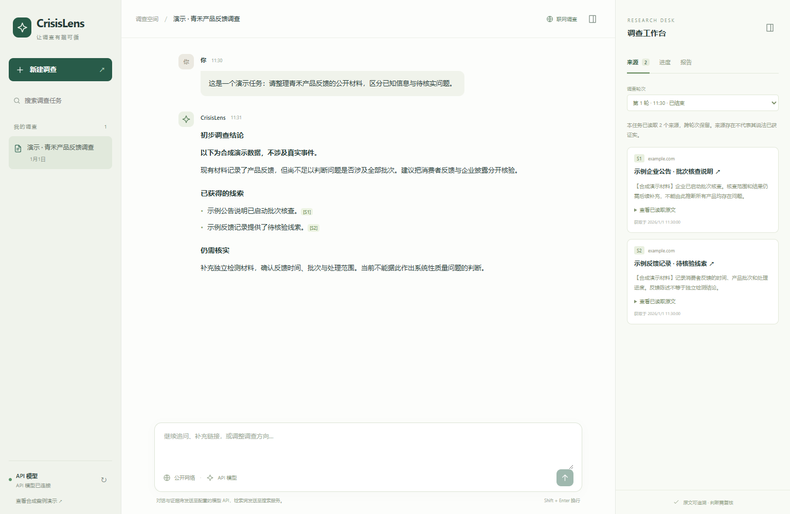

# CrisisLens

对话式舆情调查工作台：通过配置的模型 API规划调查，搜索和读取公开网页，形成带来源引用、仍需人工复核的报告。可选接入本地 Langfuse 查看模型与工具调用。

## 工作台预览



截图来自实际前端，使用专门构造的演示数据与 example.com 占位链接，不展示真实调查记录，也不代表真实事件结论。

## 能做什么

- 对话创建调查、补充线索与继续追问，查看执行进度。
- 通过 OpenAI 兼容 Chat Completions API 调用模型，搜索公开网络并读取网页正文。
- 查看来源原文、引用及 Markdown 报告，保存本地任务与历史轮次。
- 每轮重新取得证据，阻止直接使用上一轮来源作答；对明确事件主体做文本匹配检查。
- 可选本地 Langfuse：记录调查、模型决策、搜索与网页读取。
- 提供独立的合成案例演示与确定性回归测试。

## 快速启动

需要 Node.js 24+、npm 和支持 JSON 输出的 OpenAI 兼容 API。先安装依赖：

```sh
cd crisislens
npm ci
```

复制 `.env.example` 为 `.env`，填写你自己的配置：

```dotenv
MODEL_API_BASE_URL=https://api.example.com/v1
MODEL_API_KEY=your-api-key
MODEL_API_MODEL=your-model-id
PORT=8787
```

以上全部为占位值，必须替换。Base URL 填写到 /v1 层级，不包含 /chat/completions。然后运行 `npm start` 并打开 http://127.0.0.1:8787 。`/?demo=1` 为合成案例演示入口。

后端自动读取 `.env`；API Key 不传给浏览器。页面显示通用的“API 模型”，不展示实际模型 ID。适配器使用 Bearer 鉴权、`POST /chat/completions`、`response_format: {type: "json_object"}`，并通过 `GET /models` 检查模型可用性。供应商需要支持这些接口与参数。远程地址必须使用 HTTPS；本机回环地址可使用 HTTP。

对话与已读证据会发送至配置的模型 API，检索词和网页请求会发往公开网络。此项目面向本地使用，不应直接暴露到公网。

## 可选：本地 Langfuse

安装并启动 Docker，在 `crisislens/` 中执行：

```sh
node scripts/setup-langfuse.mjs
npm run langfuse:up
npm run serve
```

若工作台服务已运行，重新启动该服务以加载追踪配置。访问 http://localhost:3000 ，使用新生成的 `deploy/langfuse/LOCAL-LOGIN.txt` 登录。初始化脚本需要联网下载官方 Compose 模板，生成本机随机凭据，遇到已有凭据会拒绝覆盖。

每个任务对应一个 session，每轮调查对应一个 trace；模型输入为适配器上下文，输出为解析后的决策，内部格式重试合并记录。输入与网页正文会进入本地追踪库。历史调查不会自动补传，也没有自动事实评估。停止容器可执行 `npm run langfuse:stop`。

## 开发与验证

在 `crisislens/` 中：

```sh
npm run typecheck
npm run typecheck:web
npm test
npm run web:build
npx playwright install chromium
npm run test:e2e
```

可通过 `CHROMIUM_PATH` 指定已有 Chromium。真实模型与联网追踪验证：`npm run langfuse:test`，需要先配置上述服务。

## 目录

```text
crisislens/          应用、前后端源码、测试与部署脚本
crisislens_dataset/  合成案例、测试材料及评测侧预期答案
 docs/images/        README 演示截图
```

请保持应用与数据集的相邻目录关系。数据集包含合成权限测试材料，不是真实业务合同；预期答案仅供评测，不应加入模型上下文。

## 当前边界

搜索服务可能限流或返回无关结果；网页可能无法抓取。原文引用校验和事件名称匹配不能证明结论正确，报告仍需人工复核。右侧来源面板保留任务历史来源，报告引用使用本轮证据。该项目是开发原型，不承诺事实准确率或生产可用性。

此发布副本排除了真实密钥、账号密码、数据库、对话记录、运行日志、本机绝对路径和历史开发文档。运行后产生的这些文件已通过 `.gitignore` 排除；不要手动把它们加入版本控制。仓库尚未指定开源许可证。
## 发布副本验证记录

2026-10-18，在此副本中完成：

- 后端与前端 TypeScript 类型检查通过。
- 70 项自动化测试通过。
- 7 项 Playwright 浏览器测试通过。
- 前端生产构建通过。
- README 截图已进行视觉检查，数据均为合成演示内容。

上述测试不等价于真实联网调查准确性验证；发布副本未重新执行完整的真实供应商 API / Langfuse 联调。
